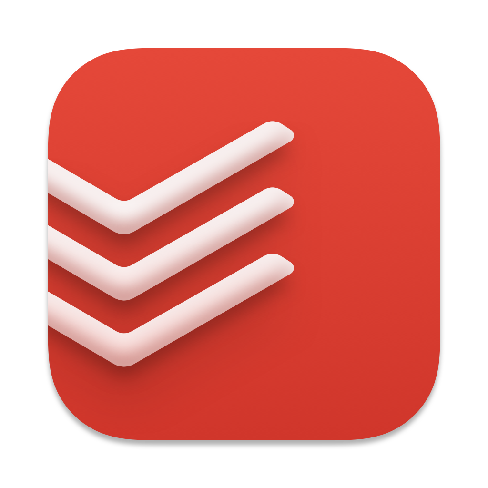
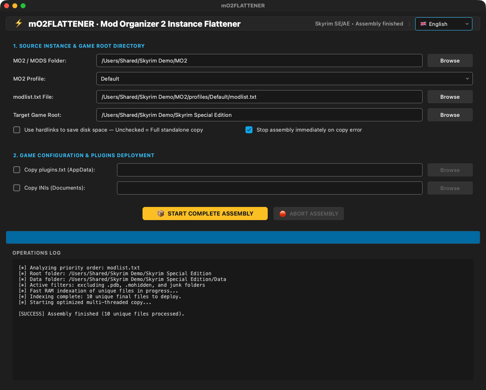

<p align="center"></p>

# mO2FLATTENER

**Turns a Mod Organizer 2 instance into a ready-to-play Skyrim folder (no virtual file system needed).**  
*Transforme une instance Mod Organizer 2 en dossier Skyrim prêt à jouer (sans système de fichiers virtuel).*

🇬🇧 [English](#-english) · 🇫🇷 [Français](#-français)

---
## 🇬🇧 English

### What it does

Mod Organizer 2's virtual file system doesn't work on a Mac. mO2FLATTENER reads your MO2 instance and its modlist.txt, resolves file conflicts in priority order and copies (or hard-links) the winning files into a real game folder you can launch with CrossOver.

### Features

- Reads the MO2 instance, its profiles and **modlist.txt** priority order (bottom wins, like MO2).
- Conflict resolution in RAM, then fast **multi-threaded copy** of the unique final files.
- Separates the game root (Root mods, Stock Game) from the **Data** folder.
- **Hard links** option to save disk space, or full standalone copy.
- Optional deployment of **plugins.txt** and the game **INI** files.
- Excludes .pdb, .mohidden and junk files; stop button and stop-on-error option.
- Interface in **English, French, Italian and Spanish** (follows your Mac's language; can be changed in the app).

### What's new in 1.1.0

- Instant APFS copies: files are cloned, which uses no extra disk space and leaves each file independent of the mod it came from. Hardlinks and full copies remain as fallbacks.
- Fix: every file was copied with a lowercase name. The original case is kept now.
- MO2 separators are ignored, and a folder named Root is only skipped at the root of a mod.

### Updates

From version 1.1.0 the app checks once a day whether a newer release exists on GitHub and offers to open the Nexus page, remind you later or skip that version. Nothing is downloaded or installed automatically. The full history is in [CHANGELOG.md](CHANGELOG.md).

### Screenshots


*Assembly of an MO2 instance with its log*

### Requirements

A Mac with **Apple Silicon** (M1 or later), **macOS 13 Ventura** or later. No Python, no Wine, no virtual machine needed.

### Installation

1. Download the zip from Nexus Mods (or from the GitHub releases) and unzip it.
2. Move **mO2FLATTENER.app** to your **Applications** folder.
3. First launch: the app is signed with a personal certificate but **not notarized by Apple**, so macOS blocks it. Open **System Settings → Privacy & Security**, scroll down and click **Open Anyway** next to mO2FLATTENER, then confirm. On macOS 14 or earlier you can also right-click the app → **Open** → **Open**.
4. Still blocked? In Terminal: `xattr -dr com.apple.quarantine /Applications/mO2FLATTENER.app`

### How to use

1. Choose the **MO2 / MODS folder** (the instance root or its mods folder); the profile and modlist.txt are found automatically.
2. Choose the **Target game root** (a copy of Skyrim Special Edition, ideally empty or a clean Stock Game).
3. Optionally tick plugins.txt / INI deployment and pick their destination.
4. Click **START COMPLETE ASSEMBLY** and follow the log.

### FAQ

**Should I use hard links?**  
Only if the MO2 instance and the target folder are on the same disk. Otherwise use a full copy.

### Building from source

Requires Python 3.12 with PyQt6 and PyInstaller. From the repository folder:

```bash
./build_app.sh
```

### License

Released under the **MIT License**: free to use, modify and share. Part of the **Skyrim Mac Toolkit**, a set of modding tools built for Skyrim players on Mac.

---

## 🇫🇷 Français

### À quoi ça sert

Le système de fichiers virtuel de Mod Organizer 2 ne fonctionne pas sur Mac. mO2FLATTENER lit votre instance MO2 et son modlist.txt, résout les conflits de fichiers dans l'ordre de priorité et copie (ou relie en dur) les fichiers gagnants dans un vrai dossier de jeu à lancer avec CrossOver.

### Fonctions

- Lit l'instance MO2, ses profils et l'ordre de priorité de **modlist.txt** (le bas gagne, comme dans MO2).
- Résolution des conflits en mémoire, puis **copie multi-thread** rapide des fichiers finaux uniques.
- Sépare la racine du jeu (mods Root, Stock Game) du dossier **Data**.
- Option **liens physiques** pour économiser l'espace disque, ou copie autonome complète.
- Déploiement facultatif de **plugins.txt** et des fichiers **INI** du jeu.
- Exclut les .pdb, .mohidden et fichiers parasites ; bouton d'arrêt et option d'arrêt sur erreur.
- Interface en **français, anglais, italien et espagnol** (suit la langue du Mac ; modifiable dans l'appli).

### Nouveautés de la 1.1.0

- Copies APFS instantanées : les fichiers sont clonés, sans place disque en plus et sans lien avec le mod d'origine. Les liens physiques et les copies complètes restent en repli.
- Correctif : tous les fichiers étaient copiés avec un nom en minuscules. La casse d'origine est maintenant conservée.
- Les séparateurs MO2 sont ignorés, et un dossier nommé Root n'est écarté qu'à la racine d'un mod.

### Mises à jour

À partir de la version 1.1.0, l'appli vérifie une fois par jour si une version plus récente existe sur GitHub et propose d'ouvrir la page Nexus, de rappeler plus tard ou d'ignorer cette version. Rien n'est téléchargé ni installé automatiquement. L'historique complet est dans [CHANGELOG.md](CHANGELOG.md).

### Captures d'écran


*Assemblage d'une instance MO2 avec son journal*

### Configuration requise

Un Mac **Apple Silicon** (M1 ou plus récent), **macOS 13 Ventura** ou plus récent. Ni Python, ni Wine, ni machine virtuelle.

### Installation

1. Téléchargez le zip sur Nexus Mods (ou dans les releases GitHub) et décompressez-le.
2. Placez **mO2FLATTENER.app** dans votre dossier **Applications**.
3. Premier lancement : l'appli est signée avec un certificat personnel mais **pas notarisée par Apple**, macOS la bloque donc. Ouvrez **Réglages Système → Confidentialité et sécurité**, descendez et cliquez sur **Ouvrir quand même** à côté de mO2FLATTENER, puis confirmez. Sous macOS 14 ou antérieur, vous pouvez aussi faire clic droit sur l'appli → **Ouvrir** → **Ouvrir**.
4. Toujours bloquée ? Dans le Terminal : `xattr -dr com.apple.quarantine /Applications/mO2FLATTENER.app`

### Utilisation

1. Choisissez le **dossier MO2 / MODS** (racine de l'instance ou son dossier mods) ; le profil et modlist.txt sont trouvés automatiquement.
2. Choisissez la **racine du jeu cible** (une copie de Skyrim Special Edition, idéalement vide ou un Stock Game propre).
3. Cochez si besoin le déploiement de plugins.txt / des INI et choisissez leur destination.
4. Cliquez sur **LANCER L'ASSEMBLAGE COMPLET** et suivez le journal.

### Questions fréquentes

**Faut-il utiliser les liens physiques ?**  
Seulement si l'instance MO2 et le dossier cible sont sur le même disque. Sinon, faites une copie complète.

### Compiler depuis les sources

Nécessite Python 3.12 avec PyQt6 et PyInstaller. Depuis le dossier du dépôt :

```bash
./build_app.sh
```

### Licence

Publié sous **licence MIT** : libre d'utilisation, de modification et de partage. Fait partie du **Skyrim Mac Toolkit**, un ensemble d'outils de modding pensés pour les joueurs de Skyrim sur Mac.
