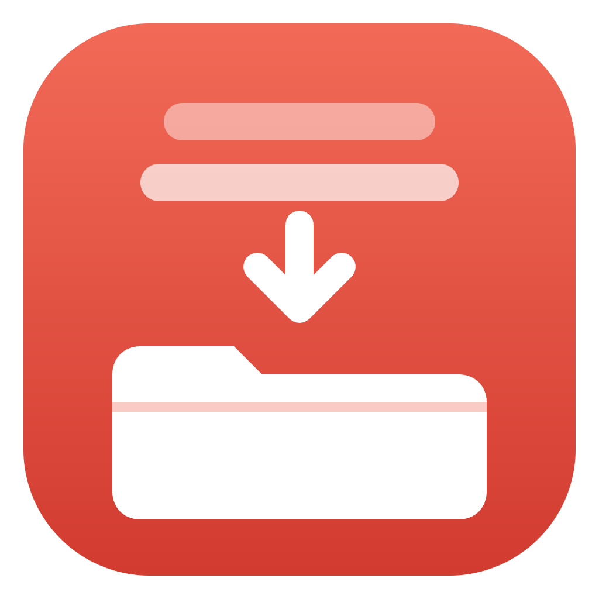
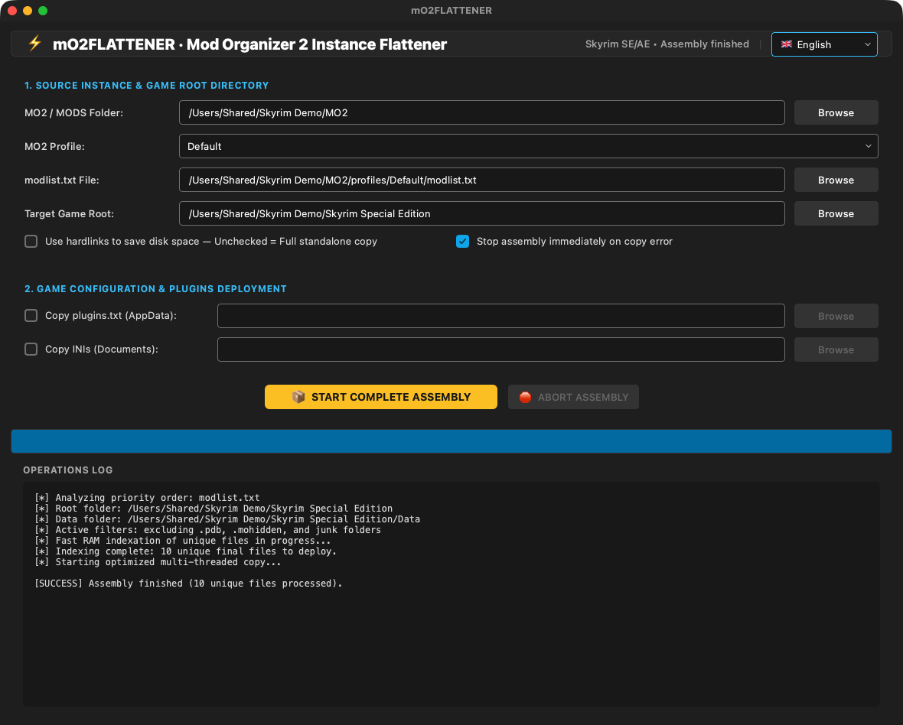

<p align="center"></p>

# mO2FLATTENER

**Turns a Mod Organizer 2 instance into a ready-to-play Skyrim folder (no virtual file system needed).**  
*Transforme une instance Mod Organizer 2 en dossier Skyrim prêt à jouer (sans système de fichiers virtuel).*

🇬🇧 [English](#-english) · 🇫🇷 [Français](#-français)

💬 **Support & community:** [Discord](https://discord.gg/xdDVDPQsYs) · *Aide et communauté : [Discord](https://discord.gg/xdDVDPQsYs)*

---
## 🇬🇧 English

### What it does

Mod Organizer 2's virtual file system doesn't work on a Mac. mO2FLATTENER reads your MO2 instance and its modlist.txt, resolves file conflicts in priority order and copies (or hard-links) the winning files into a real game folder you can launch with CrossOver.

### Features

- Reads the MO2 instance, its profiles and **modlist.txt** priority order (bottom wins, like MO2).
- Conflict resolution in RAM, then fast **multi-threaded copy** of the unique final files.
- Separates the game root (Root mods, Stock Game) from the **Data** folder.
- **Hard links** option to save disk space, or full standalone copy.
- Optional deployment of **plugins.txt** and the game **INI** files.
- **Mac adaptation** (DXMT, ENB, DLSS) at the end of the assembly: each fix is announced beforehand, shown in a « Mac report » card afterwards and can be undone one by one or all at once. Bottled Shaders is never downloaded or bundled: the report points to an archive already in your MO2 or mABBAJACK downloads, or to its Nexus page.
- Excludes .pdb, .mohidden and junk files; stop button and stop-on-error option.
- Interface in **English, French, Italian and Spanish** (follows your Mac's language; can be changed in the app).
- Rebuilt as a **native Swift app** (no more Python or PyInstaller): same features and same results (checked file by file against the previous version on a real Nolvus instance and on test instances), faster to start, and not flagged by antivirus scanners. Your language setting is carried over.

### What's new in 1.4.0

- **Mac adaptation** (DXMT, ENB, DLSS) after the assembly, with a choice: universal folder (Stock, nothing added or changed) or kit for a CrossOver bottle; every fix is announced, reported afterwards and can be undone. An already adapted game says so.
- Automatic updates: release notes in your language, then "Install and relaunch" (checksum, Developer ID signature and notarization checked). If you are on 1.3.0, install this version by hand once.
- New "Language" menu in the menu bar; progress bar and percentage in the Dock icon during the assembly.

### What's new in 1.3.0

- Signed with a Developer ID and notarized by Apple: macOS now opens the app without a security warning.
- The app's launcher is now compiled from source when the app is built, instead of using PyInstaller's generic prebuilt launcher, which antivirus scanners tend to flag. No change in features.
- The first letter of the app's name now uses the colour of its logo everywhere it appears.
- Version number aligned across the Skyrim Mac Toolkit.

### Updates

The app checks once a day whether a newer release exists on GitHub, shows its notes in your language and offers to install it and relaunch (or to remind you later or skip that version). The download is checked (SHA-256, Developer ID signature, notarization) before it replaces the app. "Check for updates…" in the menu does the same on demand. The full history is in [CHANGELOG.md](CHANGELOG.md).

### Screenshots


*Assembly of an MO2 instance with its log*

### Requirements

A Mac with **Apple Silicon** (M1 or later), **macOS 15 Sequoia** or later. No Python, no Wine, no virtual machine needed.

### Installation

1. Download the zip from Nexus Mods (or from the GitHub releases) and unzip it.
2. Move **mO2FLATTENER.app** to your **Applications** folder.

### How to use

1. Choose the **MO2 / MODS folder** (the instance root or its mods folder); the profile and modlist.txt are found automatically.
2. Choose the **Target game root** (a copy of Skyrim Special Edition, ideally empty or a clean Stock Game).
3. Optionally tick plugins.txt / INI deployment and pick their destination.
4. Click **START COMPLETE ASSEMBLY** and follow the log.

### FAQ

**Should I use hard links?**  
Only if the MO2 instance and the target folder are on the same disk. Otherwise use a full copy.

### Building from source

Requires macOS 15 and the Swift 6 toolchain (Xcode or Command Line Tools). The `mackit` tool of the shared Mac engine is embedded if found (`MACKIT_BIN=<path>` otherwise). From the repository folder:

```bash
./build_app.sh
```

### License

Released under the **MIT License**: free to use, modify and share. Part of the **Skyrim Mac Toolkit**, a set of modding tools built for Skyrim players on Mac.

---

## 🇫🇷 Français

### À quoi ça sert

Le système de fichiers virtuel de Mod Organizer 2 ne fonctionne pas sur Mac. mO2FLATTENER lit votre instance MO2 et son modlist.txt, résout les conflits de fichiers dans l'ordre de priorité et copie (ou relie en dur) les fichiers gagnants dans un vrai dossier de jeu à lancer avec CrossOver.

### Fonctions

- Lit l'instance MO2, ses profils et l'ordre de priorité de **modlist.txt** (le bas gagne, comme dans MO2).
- Résolution des conflits en mémoire, puis **copie multi-thread** rapide des fichiers finaux uniques.
- Sépare la racine du jeu (mods Root, Stock Game) du dossier **Data**.
- Option **liens physiques** pour économiser l'espace disque, ou copie autonome complète.
- Déploiement facultatif de **plugins.txt** et des fichiers **INI** du jeu.
- **Adaptation au Mac** (DXMT, ENB, DLSS) à la fin de l'assemblage : chaque correctif est annoncé avant, détaillé ensuite dans une carte « Bilan Mac » et annulable un par un ou tout d'un coup. Bottled Shaders n'est jamais téléchargé ni embarqué : le bilan indique l'archive déjà présente dans les téléchargements de MO2 ou de mABBAJACK, ou renvoie à sa page Nexus.
- Exclut les .pdb, .mohidden et fichiers parasites ; bouton d'arrêt et option d'arrêt sur erreur.
- Interface en **français, anglais, italien et espagnol** (suit la langue du Mac ; modifiable dans l'appli).
- Réécrite en **application Swift native** (plus de Python ni de PyInstaller) : mêmes fonctions et mêmes résultats (vérifiés fichier par fichier contre la version précédente sur une vraie instance Nolvus et sur des instances d'essai), démarrage plus rapide, plus de faux positifs antivirus. Votre réglage de langue est repris.

### Nouveautés de la 1.4.0

- **Adaptation au Mac** (DXMT, ENB, DLSS) après l'assemblage, au choix : dossier universel (Stock, rien n'est ajouté ni modifié) ou kit pour une bouteille CrossOver ; chaque correctif est annoncé, détaillé ensuite et annulable. Un jeu déjà adapté le dit.
- Mise à jour automatique : notes de version dans votre langue, puis « Installer et relancer » (empreinte, signature Developer ID et notarisation vérifiées). Si vous êtes en 1.3.0, installez cette version à la main une fois.
- Nouveau menu « Langue » dans la barre de menus ; jauge de progression et pourcentage dans l'icône du Dock pendant l'assemblage.

### Nouveautés de la 1.3.0

- Signée avec un certificat Developer ID et notarisée par Apple : macOS ouvre désormais l'appli sans avertissement de sécurité.
- Le lanceur de l'appli est maintenant compilé depuis les sources à la construction de l'appli, au lieu du lanceur générique précompilé de PyInstaller, souvent signalé par les antivirus. Aucun changement de fonctionnalités.
- La première lettre du nom de l'appli prend la couleur de son logo partout où il est écrit.
- Numéro de version commun à tout le Skyrim Mac Toolkit.

### Mises à jour

L'appli vérifie une fois par jour si une version plus récente existe sur GitHub, affiche ses notes dans votre langue et propose de l'installer et de se relancer (ou de rappeler plus tard, ou d'ignorer cette version). Le téléchargement est contrôlé (SHA-256, signature Developer ID, notarisation) avant de remplacer l'appli. « Rechercher les mises à jour… » dans le menu fait de même à la demande. L'historique complet est dans [CHANGELOG.md](CHANGELOG.md).

### Captures d'écran


*Assemblage d'une instance MO2 avec son journal*

### Configuration requise

Un Mac **Apple Silicon** (M1 ou plus récent), **macOS 15 Sequoia** ou plus récent. Ni Python, ni Wine, ni machine virtuelle.

### Installation

1. Téléchargez le zip sur Nexus Mods (ou dans les releases GitHub) et décompressez-le.
2. Placez **mO2FLATTENER.app** dans votre dossier **Applications**.

### Utilisation

1. Choisissez le **dossier MO2 / MODS** (racine de l'instance ou son dossier mods) ; le profil et modlist.txt sont trouvés automatiquement.
2. Choisissez la **racine du jeu cible** (une copie de Skyrim Special Edition, idéalement vide ou un Stock Game propre).
3. Cochez si besoin le déploiement de plugins.txt / des INI et choisissez leur destination.
4. Cliquez sur **LANCER L'ASSEMBLAGE COMPLET** et suivez le journal.

### Questions fréquentes

**Faut-il utiliser les liens physiques ?**  
Seulement si l'instance MO2 et le dossier cible sont sur le même disque. Sinon, faites une copie complète.

### Compiler depuis les sources

Nécessite macOS 15 et la chaîne d'outils Swift 6 (Xcode ou Command Line Tools). L'outil `mackit` du moteur Mac commun est embarqué s'il est trouvé (`MACKIT_BIN=<chemin>` sinon). Depuis le dossier du dépôt :

```bash
./build_app.sh
```

### Licence

Publié sous **licence MIT** : libre d'utilisation, de modification et de partage. Fait partie du **Skyrim Mac Toolkit**, un ensemble d'outils de modding pensés pour les joueurs de Skyrim sur Mac.
